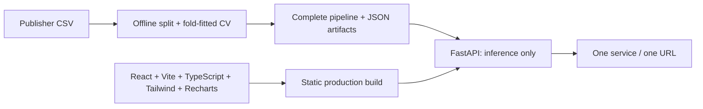

[Ti?ng Vi?t / Bilingual overview](README.md) | [Bilingual notebook](notebooks/StrokeLens_Analysis_EN_VI.ipynb) | [Current validation](docs/VALIDATION.md)

# StrokeLens — Explainable Stroke Risk Explorer

A bilingual EN/VI educational ML case study with real offline training, a persisted scikit-learn pipeline, an inference-only FastAPI service, and an editorial React interface. **No diagnosis, screening advice, clinical decision support, or validated personal future-stroke probability.**


[Vietnamese mobile screenshot](docs/screenshot-mobile.png).

## Experience

Five functional sections: the audited story; interactive source distributions and denominators; CV/holdout model comparisons, PR and threshold exploration, reliability and confusion matrix; a validated fictional-profile simulator calling the real API; and permutation importance plus exact Logistic Regression log-odds decomposition. English is default; all explanatory text, controls, chart labels, notices and errors have Vietnamese translations. Preference persists locally.

## Verified results

Original publisher CSV: 5,110 records, 249 recorded positives, 201 missing BMI. No rows removed. The historical Excel-based notebook's decimal corruption was reproduced and avoided by rebuilding from original CSV bytes. See [source audit](docs/SOURCE_AUDIT.md) and [provenance](docs/provenance.json). The source PDF, notebook and master prompt were preserved, not copied into the public project.

Development: 4,088 records, 199 positives; untouched final holdout: 1,022 records, 50 positives. Three-fold stratified development CV evaluates ten configurations across five model families. All learned imputation and scaling stay inside each training fold; one-hot categories use the publisher vocabulary. Class weights replace category-unsafe SMOTE. A majority-class baseline is included.

Selection was declared before fitting: maximize precision at pooled OOF recall ≥ .75; require precision ≥ .10, then maximize average precision (AP). Within .01 AP of the best, favor simplicity in fixed candidate order. Winner: **Logistic Regression, C=.1, balanced class weights**, deployed threshold **.5365964849**. The final pipeline is refitted on development only; holdout predictions are computed once after selection.

| Metric | Development OOF (selection) | Final holdout |
|---|---:|---:|
| Average precision | .1793 | .1715 |
| Recall | .7940 | .8200 |
| Precision | .1456 | .1470 |
| F1 | .2461 | .2492 |
| ROC-AUC | .8309 | .8534 |
| Accuracy | .7632 | .7583 |
| Brier | .1724 | .1737 |

Holdout confusion: TN 734, FP 238, FN 9, TP 41. Recall 95% Wilson interval: **.6920–.9023**, conditional on this single split and fixed selected procedure. Majority baseline: accuracy .9511, recall 0, AP .0489, Brier .0489. AP denotes average precision, not trapezoidal PR-AUC.

The model ranks positives better than the baseline while producing many false positives. Its Brier score is worse than the baseline: **scores are poorly calibrated for probability interpretation**. No post-hoc calibration was fitted; limited development positives and no clinical use case favor reporting the limitation. SVC's internal probability fitting occurs only inside each outer training fold and is separate from the selected LR's calibration assessment. All ten settings, fold AP, curves, environment and version are in [generated metrics](artifacts/metrics.json); policy is frozen in [experiment policy](artifacts/experiment_policy.json). Selected OOF estimates are optimistic after selection; final holdout is not external validation.

## Architecture



```text
backend/       schema.py · train.py · app.py
frontend/      src/ · package.json · package-lock.json
artifacts/     model.joblib · metrics.json · eda.json · schema.json · policy
scripts/       download_data.py · audit_sources.py · check-i18n.mjs
tests/         real artifact/API + schema/leakage checks
docs/          source audit · provenance · integrity · portfolio · delivery checks
.github/       one CI workflow
```

No database, authentication, cloud credentials, ORM or training at request time. `/api/*` takes precedence over SPA fallback; unknown API paths return 404. Numerical requests reject nonfinite/out-of-support values, invalid categories and extra fields. Missing BMI is explicitly allowed. Error responses do not echo submitted health values. Inputs are not stored by the application.

## Reproduce locally

Use **Python 3.14** (verified 3.14.8) and **Node 24** (verified 24.21.0); dependencies are pinned, with a complete Python lock and npm lock. Commands below start in this `strokelens` folder. On Windows PowerShell, `npm.cmd` avoids the machine's disabled `npm.ps1`; no execution-policy change is needed.

```powershell
python -m venv .venv
& .\.venv\Scripts\python.exe -m pip install -r requirements-lock.txt
& .\.venv\Scripts\python.exe scripts/download_data.py
& .\.venv\Scripts\python.exe -m backend.train
Set-Location frontend
npm.cmd ci
npm.cmd run check:i18n
npm.cmd run build
Set-Location ..
& .\.venv\Scripts\python.exe -m pytest -q
& .\.venv\Scripts\python.exe -m uvicorn backend.app:app --host 127.0.0.1 --port 8000
```

Open **http://127.0.0.1:8000**. Stop with Ctrl+C. This is a local address, not a hosted deployment. Model and JSON artifacts are supplied, so downloading/retraining is optional for running the delivered app. Downloader retrieves version 1 from the authoritative Kaggle endpoint and refuses to overwrite different raw data. Download access may require reviewing Kaggle's current terms; never substitute a synthetic dataset.

Equivalent Bash after activating a venv: `python -m pip install -r requirements-lock.txt`, `python scripts/download_data.py`, `python -m backend.train`, `cd frontend && npm ci && npm run check:i18n && npm run build && cd ..`, `python -m pytest -q`, `python -m uvicorn backend.app:app --host 127.0.0.1 --port 8000`.

Training is offline after download and deterministic for the recorded data, seed and dependency versions. JSON checksums and version record provenance; joblib bytes may differ across environments. Re-running the fixed experiment is for reproduction, not further holdout tuning. Do not refit on the holdout while continuing to report this holdout result.

Optional development: run `npm.cmd run dev` in `frontend` and FastAPI on port 8000; Vite proxies `/api`. Optional formatting: `npm.cmd run format` / `npm.cmd run check:format`.

## Tests and verification

Tests exercise real artifacts, score/classification consistency, exact local decomposition, null BMI, `Other`/`Unknown`, malformed JSON, category and numeric validation, API/static routing, corrupted schema, training-fold-only learned statistics, source hash and split/total reconciliation. Build frontend **before** backend tests because tests check real static serving. **Historical source checks are recorded in docs/DELIVERY.md; current package checks are in docs/VALIDATION.md**. If raw CSV is absent (as in public CI), one source-reconciliation test explicitly skips; persisted-model/API checks still run.

Translation check verifies EN/VI key parity and nonempty entries; TypeScript checks dictionary shape. Browser smoke checks additionally cover English/Vietnamese forms, threshold exploration, local explanations, input failures and mobile overflow; see [delivery checks](docs/DELIVERY.md) for actual executed results. CI is configured; no remote GitHub run is claimed.

Optional browser reproduction: install `requirements-browser.txt` into the venv, keep the unified service running, then run `python scripts/browser_smoke.py`. The verified Windows run uses existing Microsoft Edge in headless mode (`channel='msedge'`); other systems need that channel available or a reviewed change to an installed browser. No browser binary is bundled.

## Single-service deployment

Build static frontend, provide the trusted matching `artifacts/` bundle and `docs/provenance.json`, install locked dependencies, then start:

```sh
python -m uvicorn backend.app:app --host 0.0.0.0 --port 8000
```

Health check: `GET /api/health`. No application secrets or environment variables are required. Select a port via Uvicorn's CLI if the host requires one. Keep one service and one origin; use a hosting platform's TLS/reverse proxy if publishing. `/api/predict` is not an artifact-upload endpoint. A checksum detects drift, not malicious joblib; load only a trusted bundle. The artifact includes scikit-learn objects and requires matching dependency versions.

Optional Docker path (multi-stage frontend + Python, no Compose): `docker build -t strokelens .` then `docker run --rm -p 8000:8000 strokelens`. This is provided for container hosts; execution status is recorded in delivery checks. Raw data, personal references, venv and draft backups are excluded from the Docker context. Public publication was not requested and has not been performed.

## Model card and limitations

Intended use: educational portfolio demonstration of source integrity, imbalance, reproducible model selection, explainability and unified serving. Target is whether stroke was recorded; no validated prospective horizon exists. Original sampling source is confidential, collection period and sampling mechanism are unknown. Selection bias, missingness mechanism, confounding, category scarcity and lack of external validation limit generalization. One `Other` record cannot support subgroup evaluation. High BMI values remain unaltered; API support bounds are sample ranges, not medical rules.

Glucose is unaltered source numeric units. mg/dL is an assumption from the historical report, not confirmed by the publisher dictionary. Do not enter mmol/L values or use this form for clinical measurement conversion. Empty BMI uses the fitted development median; unusual combinations are flagged, not silently altered. Scores, threshold and explanations must not guide care. Importance and linear terms are associations within a fitted classifier, never proof of causal medical effects.

Dataset: [Fedesoriano (2021), Stroke Prediction Dataset, version 1](https://www.kaggle.com/datasets/fedesoriano/stroke-prediction-dataset). Metadata: **Data files © Original Authors**, educational use only and author credit. Raw records are ignored and not intended for redistribution; no open license for the dataset or commercial authorization is claimed.

## Portfolio

Use the short EN/VI descriptions, three evidence-grounded CV bullets and five interview talking points in [portfolio package](docs/PORTFOLIO.md). Describe your actual reviewed contributions honestly; no claimed patient benefit, employer impact or independent unaided authorship is implied.

Technical references: [scikit-learn leakage guidance](https://scikit-learn.org/stable/common_pitfalls.html), [FastAPI static serving](https://fastapi.tiangolo.com/tutorial/static-files/), [Tailwind Vite setup](https://tailwindcss.com/docs/installation/using-vite).
