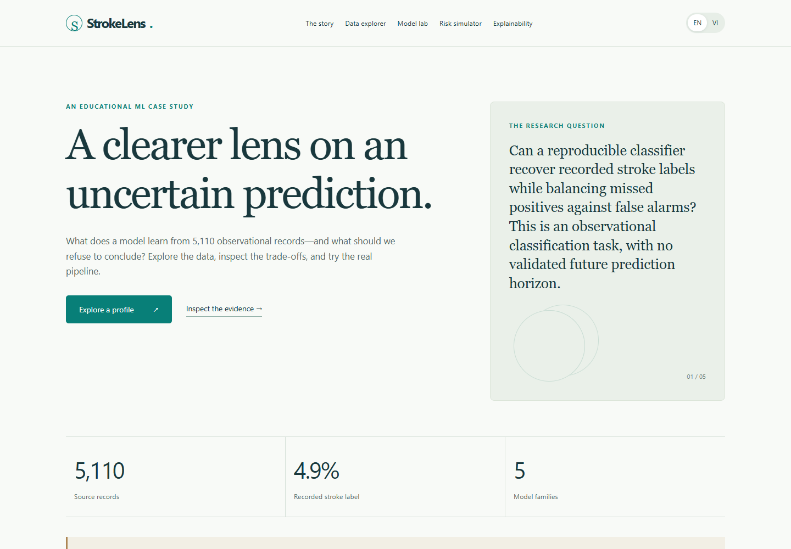

# StrokeLens — Data Analysis & Explainable Machine Learning

**Nguyễn Anh Khoa · Python · scikit-learn · FastAPI · React/TypeScript**

**VI:** Portfolio song ngữ từ đồ án cá nhân môn Machine Learning trong kinh tế. Phân tích chất lượng dữ liệu, EDA, mất cân bằng lớp và đánh giá mô hình trên nhãn đột quỵ đã được ghi nhận; có ứng dụng tương tác Anh–Việt.

**EN:** A bilingual educational case study in data quality, exploratory analysis, imbalanced classification and model evaluation, with an EN/VI FastAPI–React application. [Detailed English documentation](README.en.md).

**Phạm vi / Scope:** phục vụ học tập; không chẩn đoán, sàng lọc hoặc xác thực nguy cơ sức khỏe cá nhân. / Educational use only, not a clinical decision or personal future-risk tool.

## Xem project / Explore

- [Notebook phân tích và ML song ngữ / bilingual analysis notebook](notebooks/StrokeLens_Analysis_EN_VI.ipynb)
- [Tải dữ liệu / Data access](docs/DATA_ACCESS.md)
- [Đóng góp cá nhân / Authorship](docs/AUTHORSHIP.md)
- [Kiểm tra trong lần đóng gói này / Current validation](docs/VALIDATION.md)
- [Hướng dẫn upload / Upload guide](docs/UPLOAD_GUIDE.md)



[Giao diện mobile tiếng Việt / Vietnamese mobile screenshot](docs/screenshot-mobile.png)

## Câu hỏi và dữ liệu / Question and data

Các đặc trưng quan sát có phân biệt được nhãn `stroke` trong dữ liệu nguồn, và khi tăng khả năng phát hiện nhãn dương thì phải chấp nhận bao nhiêu cảnh báo sai?

**Nguồn:** Fedesoriano, Stroke Prediction Dataset, Kaggle version 1. Một dòng là một hồ sơ quan sát; `id` không dùng làm feature. Có 5.110 hồ sơ, 249 nhãn dương (4,87%) và 201 BMI thiếu. Không có ngày thu thập hoặc thời hạn dự báo tương lai được xác minh.

**EN:** Can observed features distinguish the recorded label, and what is the precision/recall trade-off? The source contains 5,110 records, 249 positives and 201 missing BMI values; sampling and prospective prediction horizon are unknown.

## Phương pháp / Methods

1. Kiểm tra checksum, schema, missingness, danh mục, khóa và lỗi nhập số thập phân.
2. EDA có mẫu số và giới hạn diễn giải; giữ `Other`, `Unknown`, BMI thiếu và quan sát cực trị.
3. Development/holdout 80/20, phân tầng, seed 42; preprocessing fit trong fold.
4. So sánh 5 họ / 10 cấu hình bằng CV 3 fold; chọn mô hình/ngưỡng trên OOF của development theo chính sách khai báo trước.
5. Báo cáo holdout, baseline, false positives, uncertainty và calibration; không tối ưu tiếp từ holdout.

**EN:** Validate original CSV integrity; explore with denominators; retain rare/unknown categories and missing BMI; use fold-fitted preprocessing, development-only selection and a fixed holdout. Repeating this notebook reproduces the same experiment, not an independent test.

## Kết quả / Results

Mô hình chọn: **balanced Logistic Regression, C=0.1**, ngưỡng khoảng **0.5366**. Development 4.088 hồ sơ; holdout 1.022 hồ sơ, có 50 nhãn dương.

| Metric | Holdout |
|---|---:|
| Average precision (AP) | 0.1715 |
| ROC-AUC | 0.8534 |
| Recall | 82.0% (41/50) |
| Precision | 14.7% (41/279) |
| F1 | 0.2492 |
| False positives | 238 |
| False negatives | 9 |
| Brier score | 0.1737 |

Recall Wilson 95% CI: 0.692–0.902. Baseline lớp đa số có accuracy khoảng 95,1% nhưng recall 0; accuracy cao một mình không đủ đánh giá bài toán này. Brier của mô hình cao hơn baseline 0.0489, vì vậy score không được diễn giải như xác suất nguy cơ đã hiệu chỉnh.

**EN:** The classifier detects 41 of 50 holdout positives but produces 238 false positives. Poor calibration, only 50 positive holdout cases, unknown sampling and no external validation materially limit interpretation. Features/explanations are associations, not causal effects or medical advice.

## Chạy lại notebook / Run the notebook

Từ thư mục gốc StrokeLens, dùng Python 3.14 theo môi trường gốc đã kiểm tra:

```powershell
python -m venv .venv
.\.venv\Scripts\python.exe -m pip install -r requirements-notebook.txt
.\.venv\Scripts\python.exe scripts/download_data.py
```

Mở notebook trong VS Code/Jupyter, chọn kernel của `.venv` rồi **Restart Kernel → Run All**. Hoặc:

```powershell
.\.venv\Scripts\python.exe scripts/verify_portfolio_notebook.py
```

CSV không được đóng gói; đọc [DATA_ACCESS.md](docs/DATA_ACCESS.md). Outputs mới nằm trong `outputs/`, tách khỏi dữ liệu nguồn và bị Git ignore. Các lệnh cài đặt trên dành cho người dùng tái lập; phiên đóng gói này tái sử dụng môi trường có sẵn.

## Chạy ứng dụng / Run the application

Model và JSON artifacts đã được cung cấp; chạy app không cần tải CSV hoặc huấn luyện lại. Cần frontend build và các dependency Python trong lock file.

```powershell
.\.venv\Scripts\python.exe -m pip install -r requirements-lock.txt
Set-Location frontend
npm.cmd ci
npm.cmd run check:i18n
npm.cmd run build
Set-Location ..
.\.venv\Scripts\python.exe -m uvicorn backend.app:app --host 127.0.0.1 --port 8000
```

Mở `http://127.0.0.1:8000`; dừng bằng Ctrl+C. Đây là địa chỉ local, chưa phải website đã publish. Node 24 được dùng trong môi trường đã kiểm tra. Dùng `npm` thay `npm.cmd` trên hệ điều hành khác. Xem [English technical documentation](README.en.md) để biết training, tests và Docker.

## Cấu trúc / Structure

```text
notebooks/   bilingual analysis and ML report
backend/     training, schema validation, FastAPI
frontend/    React + TypeScript + EN/VI translations
artifacts/   saved trusted model and aggregate metrics
data/raw/    empty; download original CSV separately
docs/        provenance, data access, authorship, validation
scripts/     download, translation checks, notebook/browser validation
tests/       model/API/input and leakage checks
```

## Đóng góp / Contribution

Tác giả trực tiếp thực hiện phần ML của đồ án cá nhân. Phiên bản cải thiện phương pháp, tài liệu, notebook song ngữ và FastAPI/React sử dụng AI hỗ trợ; không tự nhận đã độc lập viết toàn bộ ứng dụng. Trước phỏng vấn, cần tự chạy và giải thích từng bullet CV. Xem [AUTHORSHIP.md](docs/AUTHORSHIP.md).

**EN:** Individual coursework ML by the author; AI-assisted refinement, bilingual packaging and application extension. No measured patient benefit, commercial savings or production usage is claimed.
